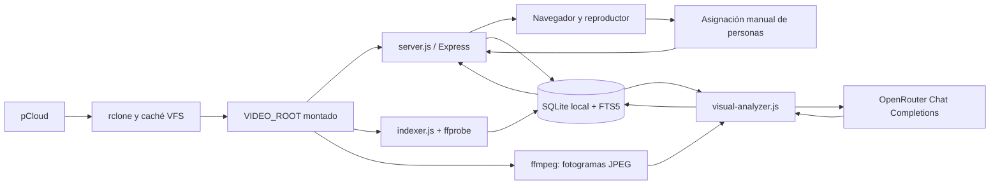

# Arquitectura y modelo de datos

[Volver al README](../README.md)

## Componentes y circulación de datos

La aplicación lee archivos a través del montaje; no utiliza directamente la API de pCloud. rclone administra credenciales, acceso remoto y caché. Aunque solo se envían fotogramas a OpenRouter, leer y buscar posiciones con ffprobe/ffmpeg puede descargar una cantidad importante del archivo a la caché local.

El servidor, el indexador y el analizador son procesos independientes que comparten una base SQLite local. La API no ofrece rutas para arrancar trabajos. systemd ejecuta los procesos; solo el indexador tiene un temporizador incluido. El indexador y el analizador reclaman en una transacción un bloqueo SQLite común para toda la biblioteca y otro propio de su etapa; una segunda tarea concurrente termina con error. Los bloqueos huérfanos del mismo host se recuperan al detectar que el PID ya no existe.

## Inventario y extracción técnica

`indexer.js` recorre recursivamente `VIDEO_ROOT`, omite enlaces simbólicos y reconoce las extensiones definidas en el código. Cada video se identifica por su ruta relativa única. Su fingerprint es `tamaño:mtimeRedondeadoEnMilisegundos`; no es un hash del contenido.

Cada recorrido hace upsert de archivos vistos. Un archivo nuevo, modificado o previamente marcado `missing` vuelve a `pending`. Cambiar el fingerprint invalida los campos técnicos y visuales, pero hoy no elimina inmediatamente las filas de asociaciones de personas: ver [Mejoras](mejoras.md).

El modo normal analiza archivos elegibles mediante ffprobe, de uno en uno, con timeout configurado de 30 segundos y hasta 4 MiB de salida. Omite archivos terminados sin cambios y los fallidos sin cambios salvo `RETRY_FAILED=1`. El límite de 50 afecta a intentos de análisis, no al número de archivos recorridos. Incluso al alcanzar ese límite continúa el inventario completo.

Tras un recorrido completo, los registros no vistos quedan `missing`; no se borran. Si hay un fallo de lectura que interrumpe el recorrido, no se aplica ese marcado global. También se rechaza un recorrido vacío si ya había videos registrados. Un fallo individual de ffprobe puede coexistir con un recorrido `done`: consultar ambos niveles.

Las fechas candidatas proceden de etiquetas de captura de contenedor/streams, de una fecha en el nombre base del archivo y de su mtime. Se valida el día calendario. Solo se elige `recorded_at` cuando las fuentes distintas de mtime contienen un único día; se guarda precisión `day`. No se infiere de carpetas, audio o imágenes.

## Análisis visual

1. Reclama en una transacción el bloqueo común de biblioteca y el de la etapa visual, registra la configuración sin secretos y exige `OPENROUTER_API_KEY`. Si una instancia anterior dejó filas `running`, las convierte en fallidas con reintento diferido.
2. Selecciona videos con estado técnico `done`, prioriza pendientes y después fallidos transitorios vencidos cuando `RETRY_VISUAL_FAILED=1`. `VISUAL_VIDEO_ID` selecciona un video concreto para regenerarlo. El máximo automático de intentos por fingerprint es cinco por defecto.
3. Comprueba ruta real, tamaño y mtime contra el fingerprint guardado.
4. Extrae imágenes al 8 %, 35 %, 65 % y 92 % de la duración, redondeando a segundos y eliminando duplicados. Usa el segundo cero si no hay duración o es menor a dos segundos.
5. Genera JPEG de hasta 768 × 768 conservando proporciones, con 45 segundos de timeout por extracción. Rechaza una imagen mayor de 700.000 bytes. Si falla algún fotograma puede continuar con los restantes; si fallan todos, falla el video.
6. Envía las imágenes en memoria, codificadas en base64, y sus tiempos al endpoint `/chat/completions`. Solicita JSON Schema, soporte de parámetros y un máximo de 2.000 tokens de salida, con timeout de 120 segundos.
7. Parsea JSON y valida tipos, tamaños de listas e índices de fotogramas. Convierte cada referencia en `at_seconds`. El prompt vigente es `visual-v2` y pide textos en español sin nombres inferidos.
8. Revalida el archivo antes de guardar. Persiste ficha, nueva revisión, modelo configurado, versión de prompt, uso reportado y fingerprint; reconstruye el texto de búsqueda. Las asociaciones anteriores quedan guardadas como pendientes de revisión y no se aplican a la revisión nueva.

Los errores 401/403 detienen el lote y requieren corregir credenciales o permisos. Los 429 y 5xx detienen el lote y programan espera exponencial. Fallos transitorios individuales también reciben reintento diferido; errores 4xx y respuestas rechazadas no se reintentan automáticamente. El límite automático por fingerprint es configurable. Otros fallos individuales pueden registrarse y permitir que el lote termine con código cero. Por eso «servicio finalizado con éxito» no garantiza que todas sus fichas hayan tenido éxito.

No hay caché persistente de fotogramas, historial completo de fichas visuales, presupuesto diario ni tabla general de trabajos. Sí se guardan los intentos y próximas fechas para cada video. `visual_model` guarda el selector configurado; con un router no identifica necesariamente el modelo efectivo que atendió la solicitud.

## SQLite

Archivo: `DATA_DIR/videos.sqlite`. Se habilitan WAL, claves foráneas y espera de hasta 5 segundos ante bloqueo. Los procesos crean tablas y columnas faltantes al importar `metadata-store.js`; no existe un sistema completo de migraciones versionadas. `user_version=1` se utiliza para la reconstrucción inicial del índice FTS.

| Tabla | Propósito y campos principales |
|---|---|
| `videos` | `id`, ruta única, tamaño, mtime, fingerprint; estado y error técnicos; duración/resolución/códec; fecha/evidencia; estado, título, resumen, incertidumbre, JSON de contenido y uso visual; modelo/prompt; marcas temporales; `last_seen_scan` |
| `scans` | ID, inicio, fin, estado, cantidad vista y error del recorrido |
| `process_locks` | Bloqueo de etapa con token, PID, host y adquisición |
| `worker_runs` | Último estado de ejecución, heartbeat, archivo/fase actual y resultado/error |
| `worker_configuration` | Configuración efectiva no secreta registrada por cada etapa |
| `people` | ID, nombre único con colación SQLite `NOCASE`, creación |
| `video_person_observations` | Clave `(video_id, analysis_revision, observation_index)`, descripción/segundo observados, persona, confirmación y fecha opcional de revisión; conserva identidades anteriores sin asignarlas a otra ficha |
| `video_fts` | FTS5 sobre ruta, título, resumen y texto visual agregado; contenido externo en `videos`, sincronizado con triggers |

Los campos JSON almacenan candidatos de fecha, resumen técnico, personas observadas, eventos, lugares, palabras clave, pistas de fecha, uso y nombres generales confirmados. La API conserva los campos JSON originales y agrega versiones parseadas.

Cada análisis visual recibe `visual_revision`; las asignaciones se ligan a esa revisión y guardan una copia de descripción/segundo. Tras regenerar o cambiar el fingerprint, la ficha no hereda esas identidades; la API ofrece las no revisadas en `stale_identifications`. Reasignar una observación anterior a una actual registra la revisión en la misma transacción que guarda la nueva asignación. Las observaciones no tienen ID estable entre revisiones, recorte de rostro o embedding. `confirmed_people_json` es una lista general de nombres anterior al catálogo; se mantiene mediante una ruta PATCH de compatibilidad.

## Estados

| Entidad | Estados usados |
|---|---|
| Video técnico | `pending`, `done`, `failed`, `missing` |
| Video visual | Nulo se interpreta como pendiente; `pending`, `running`, `done`, `failed` |
| Recorrido | `running`, `done`, `failed`, `interrupted`; al tomar el bloqueo, el siguiente indexador marca como interrumpidos los recorridos que quedaron `running` |

`process_locks` serializa instancias del indexador entre sí y del analizador entre sí. Usa PID y nombre de host para identificar al propietario y recuperar registros abandonados en el mismo servidor. `worker_runs` conserva heartbeat y actividad para el progreso visible; `stale` se infiere cuando el PID local desaparece. La recuperación automática presupone que los procesos usan la misma base SQLite local y el mismo host; no es un coordinador distribuido para bases compartidas entre servidores.

## Búsqueda e interfaz

FTS5 usa tokenización Unicode con eliminación de diacríticos. Se extraen hasta ocho palabras de la consulta, cada una como prefijo, combinadas con AND. Se filtran fechas inclusivas, se excluyen `missing` y se ordena por fecha descendente y ruta; no por relevancia. La búsqueda devuelve videos, no segmentos coincidentes.

`public/app.js` administra árbol, reproducción, fichas, búsqueda, directorio de personas y consulta periódica del progreso. No hay framework ni compilación del frontend. Tailwind se descarga desde CDN y la tipografía desde Google Fonts. El token de edición permanece en memoria de la página.

## Límites de acceso y privacidad

La validación de rutas usa resolución absoluta, límites relativos y comprobación del destino real cuando existe. La API de lectura y streaming no exige autenticación, escucha en `0.0.0.0` y permite CORS de forma general. Solo las mutaciones de nombres requieren bearer token con comparación de tiempo constante.

El árbol y las rutas de navegación interpolan nombres en `innerHTML`; es un riesgo de inyección HTML que debe corregirse. SQLite, los registros y las fichas contienen información personal. Los fotogramas se envían a OpenRouter y al proveedor seleccionado por ese servicio; la política de retención depende del proveedor y no la controla este código. La autorización de envío de fotogramas ya forma parte del alcance del proyecto; el audio sigue fuera del procesamiento actual.
