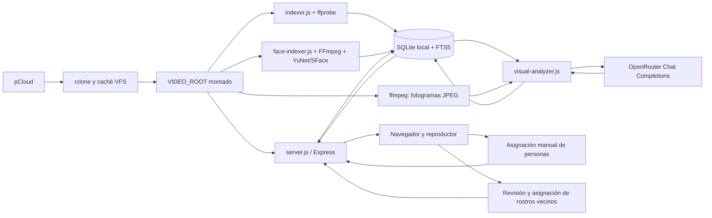

# Arquitectura y modelo de datos

[Volver al README](../README.md)

## Componentes y circulación de datos

La aplicación lee archivos a través del montaje; no utiliza directamente la API de pCloud. rclone administra credenciales, acceso remoto y caché. Aunque solo se envían fotogramas a OpenRouter, leer y buscar posiciones con ffprobe/ffmpeg puede descargar una cantidad importante del archivo a la caché local. El indexador técnico recoge tags de ubicación que ffprobe expone (por ejemplo ISO 6709) y fabricante/modelo de cámara, conserva el valor y la clave de origen en `technical_json`, y añade esos datos al texto de búsqueda. No consulta geocodificadores ni escribe en los videos. Las coordenadas pueden revelar información sensible y se mantienen en la base local de la aplicación.

El servidor, el indexador técnico, el analizador narrativo y el indexador facial son procesos independientes que comparten una base SQLite local. La descripción narrativa usa OpenRouter; el proceso de rostros usa FFmpeg y modelos OpenCV locales, sin enviar sus fotogramas al proveedor. Cada trabajador reclama en una transacción un bloqueo SQLite de su etapa; dos ejecuciones de la misma etapa no se superponen. Las distintas etapas pueden avanzar en paralelo y comprueban el fingerprint antes de guardar resultados. Los bloqueos huérfanos del mismo host se recuperan al detectar que el PID ya no existe.

## Inventario y extracción técnica

`indexer.js` recorre recursivamente `VIDEO_ROOT`, omite enlaces simbólicos y reconoce las extensiones definidas en el código. Cada video se identifica por su ruta relativa única. Su fingerprint es `tamaño:mtimeRedondeadoEnMilisegundos`; no es un hash del contenido.

Cada recorrido hace upsert de archivos vistos. Un archivo nuevo, modificado o previamente marcado `missing` vuelve a `pending`. El fingerprint actual es `tamaño:mtimeRedondeadoEnMilisegundos`, no un hash criptográfico; por eso el sidecar lo usa como control de versión práctico, no como prueba de igualdad byte por byte. Cambiar el fingerprint invalida los campos técnicos y visuales, pero hoy no elimina inmediatamente las filas de asociaciones de personas: ver [Mejoras](mejoras.md).

El modo normal analiza archivos elegibles mediante ffprobe, de uno en uno, con timeout configurado de 30 segundos y hasta 4 MiB de salida. Omite archivos terminados sin cambios y los fallidos sin cambios salvo `RETRY_FAILED=1`. El límite de 50 afecta a intentos de análisis, no al número de archivos recorridos. Incluso al alcanzar ese límite continúa el inventario completo.

Tras un recorrido completo, los registros no vistos quedan `missing`; no se borran. Si hay un fallo de lectura que interrumpe el recorrido, no se aplica ese marcado global. También se rechaza un recorrido vacío si ya había videos registrados. Un fallo individual de ffprobe puede coexistir con un recorrido `done`: consultar ambos niveles.

Las fechas candidatas proceden de etiquetas de captura de contenedor/streams, de una fecha en el nombre base del archivo y de su mtime. Se valida el día calendario. Solo se elige `recorded_at` cuando las fuentes distintas de mtime contienen un único día; se guarda precisión `day`. No se infiere de carpetas, audio o imágenes.

## Análisis visual

1. Reclama en una transacción el bloqueo de la etapa visual, registra la configuración sin secretos y exige `OPENROUTER_API_KEY`. Si una instancia anterior dejó filas `running`, las convierte en fallidas con reintento diferido.
2. Selecciona videos con estado técnico `done`, prioriza pendientes y después fallidos transitorios vencidos cuando `RETRY_VISUAL_FAILED=1`. `VISUAL_VIDEO_ID` selecciona un video concreto para regenerarlo. El máximo automático de intentos por fingerprint es cinco por defecto.
3. Comprueba ruta real, tamaño y mtime contra el fingerprint guardado.
4. Extrae imágenes al 8 %, 35 %, 65 % y 92 % de la duración, redondeando a segundos y eliminando duplicados. Usa el segundo cero si no hay duración o es menor a dos segundos.
5. Genera JPEG de hasta 768 × 768 conservando proporciones, con 45 segundos de timeout por extracción. Rechaza una imagen mayor de 700.000 bytes. Si falla algún fotograma puede continuar con los restantes; si fallan todos, falla el video.
6. Envía las imágenes en memoria, codificadas en base64, y sus tiempos al endpoint `/chat/completions` usando HTTPS y sin seguir redirecciones. Solicita JSON Schema, soporte de parámetros y un máximo de 2.000 tokens de salida, con timeout de 120 segundos. Limita la respuesta normal a 1 MiB y los cuerpos de error a 16 KiB.
7. Parsea JSON y valida tipos, tamaños de listas e índices de fotogramas. Convierte cada referencia en `at_seconds`. El prompt vigente es `visual-v2` y pide textos en español sin nombres inferidos.
8. Revalida el archivo antes de guardar. Persiste ficha, nueva revisión, modelo configurado, versión de prompt, uso reportado y fingerprint; reconstruye el texto de búsqueda. Las asociaciones anteriores quedan guardadas como pendientes de revisión y no se aplican a la revisión nueva.

Los errores 401/403 y otros 4xx del proveedor detienen el lote y pausan la etapa hasta que cambie la clave, el modelo o el endpoint. Excepción: si `openrouter/free` devuelve 404 porque no hay endpoints compatibles con los parámetros, se reintenta con espera creciente de hasta 24 h y ese fallo no consume intentos por video. Los 429, 5xx y fallos de red también detienen el lote y pausan llamadas hasta vencer una espera creciente. Fallos transitorios individuales reciben reintento diferido; respuestas rechazadas no se reintentan automáticamente. El límite automático por fingerprint es configurable. Otros fallos individuales pueden registrarse y permitir que el lote termine con código cero. Por eso «servicio finalizado con éxito» no garantiza que todas sus fichas hayan tenido éxito.

No hay caché persistente de fotogramas, historial de versiones completas de fichas visuales ni tabla general de trabajos. Sí se guardan los intentos y próximas fechas por video, un contador diario de solicitudes y un historial acotado de ejecuciones de trabajadores. `visual_model` guarda el selector configurado; con un router no identifica necesariamente el modelo efectivo que atendió la solicitud.

## SQLite

Archivo: `DATA_DIR/videos.sqlite`. Se habilitan WAL, claves foráneas y espera de hasta 5 segundos ante bloqueo. La inicialización serializa cambios de esquema en una transacción `BEGIN IMMEDIATE` y registra migraciones numeradas hasta la versión 14. Algunas compatibilidades históricas todavía se aplican al arranque fuera de ese registro. `user_version` refleja la versión registrada; la reconstrucción inicial del índice FTS también conserva su control propio.

| Tabla | Propósito y campos principales |
|---|---|
| `videos` | `id`, ruta única, tamaño, mtime, fingerprint; estado y error técnicos; duración/resolución/códec; fecha/evidencia; `technical_json` (tags y procedencia de ubicación y dispositivo); versión de extracción de metadata nativa; estado, título, resumen, incertidumbre, JSON de contenido y uso visual; modelo/prompt; marcas temporales; `last_seen_scan` |
| `scans` | ID, inicio, fin, estado, cantidad vista y error del recorrido |
| `process_locks` | Bloqueo de etapa con token, PID, host y adquisición |
| `worker_runs` | Último estado de ejecución, heartbeat, archivo/fase actual y resultado/error |
| `worker_run_history` | Historial acotado a 200 ejecuciones recientes por etapa |
| `visual_daily_requests` | Solicitudes visuales iniciadas por día UTC |
| `visual_provider_control` | Pausa persistente por error de configuración o espera de proveedor |
| `DATA_DIR/evidence/<video_id>/<revision>/*.jpg` | Fotogramas usados como evidencia; la API autenticada sirve la revisión activa y conserva las anteriores mientras tengan identidades pendientes de revisión |
| `worker_configuration` | Configuración efectiva no secreta registrada por cada etapa |
| `people` | ID, nombre único con colación SQLite `NOCASE`, creación y destino de fusión opcional |
| `video_person_observations` | Clave `(video_id, analysis_revision, observation_index)`, descripción/segundo observados, persona, confirmación y fecha opcional de revisión; conserva identidades anteriores sin asignarlas a otra ficha |
| `person_merge_history` | Historial de fusiones de catálogo, destino, estado y tiempos; conserva origen archivado para permitir deshacer |
| `person_merge_observations` | Observaciones movidas por fusión, para restaurarlas si siguen asignadas al destino |
| `video_person_identity_history` | Registro cronológico de altas, cambios, bajas y reconciliaciones humanas de identidades por revisión |
| `video_fts` | FTS5 sobre ruta, título, resumen y texto visual agregado; contenido externo en `videos`, sincronizado con triggers |
| `face_video_indexes` | Fingerprint, versión de YuNet/SFace, resultado por video, fotogramas, caras y error |
| `face_observations` | Embedding Float32 normalizado, rectángulo de cara, confianza, timestamp y revisión por fingerprint. Una detección ignorada conserva solo la referencia mínima y su estado; su vector se elimina y se mantiene excluida al reindexar ese contenido |
| `person_merge_face_observations` | Embeddings faciales cuya identidad cambió en una fusión, para poder deshacerla |

Los campos JSON almacenan candidatos de fecha, resumen técnico, ubicación y dispositivo de captura con tags de origen, personas observadas, eventos, lugares, palabras clave, pistas de fecha, uso y nombres generales confirmados. La API conserva los campos JSON originales y agrega versiones parseadas.

Las detecciones faciales ignoradas se identifican por video, fingerprint, modelo, segundo y posición de detección. Un reindexado del mismo contenido conserva la exclusión y no vuelve a guardar el embedding. Cambiar el contenido cambia el fingerprint y habilita una revisión nueva; las detecciones en otros videos se ignoran por separado.

Cada análisis visual recibe `visual_revision`; las asignaciones se ligan a esa revisión y guardan una copia de descripción/segundo. Una observación conserva una identidad principal en `video_person_observations` y las adicionales en `video_person_observation_extra_people`, con la misma revisión. Así se mantiene la lectura de clientes anteriores y se permiten grupos. Tras regenerar o cambiar el fingerprint, la ficha no hereda esas identidades; la API ofrece las anteriores en `stale_identifications`. Reasignar una observación anterior a una actual registra la revisión en la misma transacción que guarda la nueva asignación. También se puede cerrar una identificación anterior sin reasignarla; la decisión queda registrada como `dismissed`. Las observaciones no tienen ID estable entre revisiones, recorte de rostro o embedding. `confirmed_people_json` es una lista general de nombres anterior al catálogo; se mantiene mediante una ruta PATCH de compatibilidad.

La etapa facial es independiente de `visual_revision`: se liga a `(video_id, fingerprint, model_version, at_seconds, face_index)`. La versión del índice combina la etiqueta de los modelos con una huella de los parámetros que cambian resultados (intervalo y cantidad de muestras, tamaño del fotograma, tamaño mínimo de cara y umbral de detección). Cambiar cualquiera de ellos crea un índice vigente nuevo y deja las observaciones anteriores fuera de candidatos y búsquedas; cambiar el contenido del video también las invalida mediante el fingerprint. En la primera ejecución tras esta versión, las filas existentes se conservan bajo la nueva clave si la configuración guardada coincide exactamente; si cambió algún parámetro, se reindexan. La bandeja calcula los vecinos por similitud coseno a partir de un rostro elegido; el cliente confirma qué vecinos reciben `person_id`. Renombrar, fusionar y deshacer identidades también actualiza o restaura esas asignaciones. El endpoint de preview vuelve a extraer el fotograma y el recorte en memoria; no hay archivo de cara persistido.

## Estados

| Entidad | Estados usados |
|---|---|
| Video técnico | `pending`, `done`, `failed`, `missing` |
| Video visual | Nulo se interpreta como pendiente; `pending`, `running`, `done`, `failed` |
| Recorrido | `running`, `done`, `failed`, `interrupted`; al tomar el bloqueo, el siguiente indexador marca como interrumpidos los recorridos que quedaron `running` |

`process_locks` serializa cada etapa por separado. Usa PID y nombre de host para identificar al propietario y recuperar registros abandonados en el mismo servidor. `worker_runs` conserva la actividad actual; `worker_run_history` mantiene hasta 200 ejecuciones por etapa. `stale` se infiere cuando el PID local desaparece. La recuperación automática presupone que los procesos usan la misma base SQLite local y el mismo host; no es un coordinador distribuido para bases compartidas entre servidores.

`automation_control` conserva la pausa global de nuevas tareas y `automation_control_history` guarda hasta 200 cambios; los trabajos ya activos terminan. `schema_migrations` registra la versión base y las migraciones numeradas nuevas dentro de la inicialización transaccional. La versión 1 documenta el esquema existente como línea base; la versión 2 agrega el índice para informes mensuales de costo; la versión 3 guarda el plan de muestreo de cada ficha; la versión 4 agrega asociaciones secundarias para grupos; la versión 5 agrega el historial acotado de reintentos visuales manuales; la versión 6 amplía el historial de identidades con el conjunto completo de personas antes y después de cada edición grupal; la versión 7 registra reintentos manuales de análisis técnico; la versión 8 agregó el almacenamiento experimental de vectores visuales y la versión 10 elimina esa tabla; la versión 9 agrega los índices y observaciones faciales locales junto con referencias para deshacer fusiones. Parte de las compatibilidades históricas todavía usa cambios idempotentes en el arranque y debe trasladarse a migraciones numeradas en futuras entregas. Al cambiar el fingerprint se elimina el plan de muestreo anterior y se excluyen sus embeddings faciales del índice vigente.

La versión 11 registra el seguimiento de lectura de metadata nativa. `native_metadata_version` permite reexaminar por lotes los videos técnicos que ya estaban listos, sin reiniciar su ficha visual ni sus identidades. Las versiones 12 y 13 eliminan los vectores faciales de las detecciones marcadas como ignoradas, incluida cualquier fila rechazada por una versión anterior del servidor. El indexador toma hasta `MAX_PROBES` archivos por ejecución (50 por defecto); las siguientes ejecuciones continúan con los que falten.

La versión 15 agrega contexto editable a personas y las tablas de propuestas, reintentos y cuota de redacción. La versión 16 conserva por separado el texto generado y el texto eventualmente corregido por el usuario.

## Búsqueda e interfaz

FTS5 usa tokenización Unicode con eliminación de diacríticos. Se extraen hasta ocho palabras de la consulta, cada una como prefijo, combinadas con AND. Se filtran fechas inclusivas y se excluyen `missing`. Con consulta, los resultados priorizan relevancia; sin consulta, se ordenan por fecha descendente y ruta. La búsqueda devuelve videos, no segmentos coincidentes. El filtro de personas incluye asignaciones narrativas manuales y confirmaciones faciales ligadas al fingerprint actual.

## Portabilidad de fichas

SQLite es la fuente de verdad para fichas, ubicación, cámara e identidades confirmadas. La exportación manual crea `<video>.metadata.json` junto al archivo y conserva la ficha sin reescribir ni remuxear el original. Incluye versión de esquema, ruta relativa, fingerprint, procedencia/fecha, ficha técnica y visual, personas observadas y nombres confirmados por observaciones narrativas o rostros. No incluye embeddings faciales, recortes, datos de detección ni historial. Requiere autenticación de edición y rechaza la escritura si ya existe un sidecar. La importación solo acepta un sidecar regular menor a 2 MiB con esquema conocido, ruta y fingerprint actuales, y si todavía no hay revisión visual local. Restaura las asignaciones narrativas por nombre y la metadata técnica solo cuando falta localmente; no reaplica el resumen de rostros ni puede recrear embeddings. Si ya hay una ficha local, la operación se rechaza sin reemplazarla.

Incrustar la ficha en contenedores MP4/MOV o Matroska queda como opción posterior de exportación a una copia. Los tags de ubicación sirven para coordenadas, pero no existe una convención universal y bien soportada por reproductores para nombres de personas identificadas. La aplicación nunca debe actualizar el original automáticamente.

La integración con Jellyfin mantiene SQLite como fuente principal y actualiza el elemento de Jellyfin por API tras una vista previa y confirmación explícita. El emparejamiento usa la ruta absoluta exacta, no títulos potencialmente ambiguos. Se envían el título y resumen aprobados cuando están vigentes (o los visuales originales en su ausencia), fecha técnica disponible, tags `Archivo:` derivados de lugares/palabras clave, ubicación/coordenadas, datos de cámara y personas confirmadas; los rostros rechazados o pendientes quedan afuera. Las personas controladas por esta app llevan el rol `Identificada por Video Home`, y los tags propios el prefijo `Archivo:` para poder reemplazarlos sin borrar datos escritos en Jellyfin. La clave API se configura en el backend y nunca se serializa al navegador. El JSON portable sigue siendo un formato propio de esta app; Jellyfin no lo importa como metadata.

La etapa `refinement-worker.js` corre después de la ficha visual y usa solo texto. `people.description` contiene contexto aportado por el usuario. `video_refinements` conserva propuestas, estado de revisión, modelo y huella SHA-256 de todos los insumos vigentes (revisión visual, fingerprint, fecha, identidades faciales/narrativas y contexto de personas). Cambiar cualquiera de esos insumos vuelve obsoleta la propuesta sin borrar el historial; la siguiente ejecución crea otra. `video_refinement_attempts` controla hasta tres reintentos por huella y `refinement_daily_requests` limita llamadas por día UTC. El redactor tiene bloqueo, servicio, timer y contador propios y respeta la pausa global. Los nombres y contextos incluidos se envían a OpenRouter. Una aprobación vigente se muestra en la web, se incorpora a la búsqueda FTS y sustituye título/resumen al sincronizar con Jellyfin; la descripción visual original permanece intacta.

`public/app.js` administra árbol, reproducción, fichas, búsqueda, directorio de personas y consulta periódica del progreso. No hay framework ni compilación del frontend. Tailwind se descarga desde CDN y la tipografía desde Google Fonts. El manifiesto y el service worker permiten instalar la interfaz como PWA; este último cachea recursos estáticos y muestra una pantalla informativa sin conexión, pero nunca cachea API, streams ni fotogramas. El acceso PWA requiere HTTPS (o localhost). Con `ACCESS_TOKEN`, el navegador conserva solo una cookie de sesión `HttpOnly` de 30 días por defecto; esa sesión autoriza lectura y edición si `METADATA_EDIT_TOKEN` habilita las rutas. Sin autenticación de biblioteca, el modo local conserva el token Bearer en memoria de la página.

## Límites de acceso y privacidad

La validación de rutas usa resolución absoluta, límites relativos y comprobación del destino real cuando existe. El servidor escucha en `0.0.0.0`. Si `ACCESS_TOKEN` se configura, la API y el streaming requieren una cookie de sesión HttpOnly; sin él, el acceso permanece abierto por compatibilidad. CORS admite same-origin y orígenes exactos configurados. Con acceso protegido, la sesión también autoriza las mutaciones de nombres si está configurado `METADATA_EDIT_TOKEN`; sin `ACCESS_TOKEN`, se requiere su bearer token con comparación de tiempo constante.

Los nombres y las rutas del árbol se agregan como texto y nodos DOM, no como HTML ejecutable. SQLite, los registros y las fichas contienen información personal. Los fotogramas se envían a OpenRouter y al proveedor seleccionado por ese servicio; la política de retención depende del proveedor y no la controla este código. La autorización de envío de fotogramas ya forma parte del alcance del proyecto; el audio sigue fuera del procesamiento actual.
